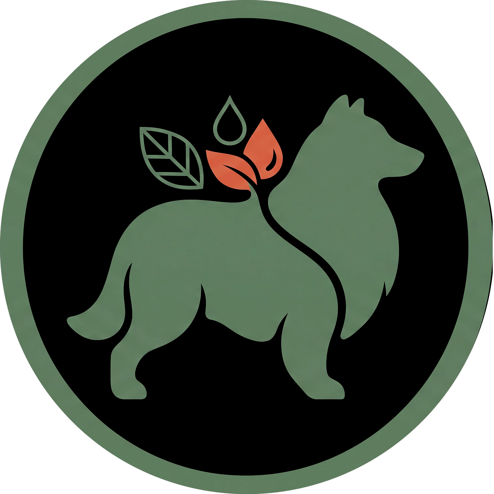

<p align="center">
  
</p>

<h1 align="center">PetCare 🐾</h1>
<p align="center">
  Aplicación web para encontrar y gestionar servicios de cuidado para mascotas.
</p>

## 📋 Descripción
PetCare es una aplicación web que permite a los propietarios de mascotas encontrar y gestionar servicios relacionados con el cuidado de sus animales de compañía.

Proyecto académico de la asignatura Análisis y Diseño de Sistemas.

## ✨ Funcionalidades disponibles
- Registro y gestión de mascotas.
- Modo demo para recorrer la interfaz.
- Registro real de propietarios en PostgreSQL.
- Registro y eliminación de mascotas.
- Panel principal responsive con logo y navegación.
- Catálogo de servicios con detalle y franjas disponibles.
- Creación de solicitudes con validación de propietario, mascota, franja y duplicados.
- Historial de solicitudes ordenado por fecha y hora.
- Cancelación de solicitudes pendientes con liberación de la franja.
- Integración coordinada con Podman Compose.

## 🚧 Estado del proyecto
> Prototipo funcional académico en evolución. El flujo principal de propietario, mascota, servicios, solicitudes, historial y cancelación está conectado al backend. La autenticación JWT y las notificaciones quedan como trabajo futuro del MVP.

## 🛠️ Tecnologías
- Frontend: HTML, CSS y JavaScript.
- Backend: Java 17 y Spring Boot.
- Persistencia: PostgreSQL.
- Entorno: Podman Compose.
- Diseño: Figma/FigCraft y archivos HTML/CSS de referencia.

## ▶️ Instalación y ejecución

Requisitos: Podman y `podman compose`.

Desde la raíz del repositorio:

```bash
podman compose up -d --build
```

Abrir `http://localhost:5173`.

Para detener los servicios sin eliminar la base de datos:

```bash
podman compose down
```

El usuario demo puede entrar con `demo@petcare.test` y cualquier contraseña de mínimo cuatro caracteres. Para probar persistencia real, usar la opción **Crear cuenta**.

Servicios: frontend `5173`, backend `8080`, PostgreSQL `5432`.

### Flujo de demostración

1. Crear una cuenta y registrar una mascota en **Mis mascotas**.
2. Entrar a **Servicios**, abrir un servicio y seleccionar una franja libre.
3. Elegir la mascota y pulsar **Solicitar**. La solicitud queda en estado **Pendiente**.
4. Entrar a **Solicitudes** para consultar fecha, hora, servicio, mascota y estado.
5. Pulsar **Cancelar** y confirmar. La solicitud queda **Cancelada** y la franja vuelve a estar disponible.

### API principal

- `GET /services` y `GET /services/{id}`: catálogo y detalle.
- `GET /services/{id}/slots/free`: franjas libres.
- `POST /service-requests`: crear una solicitud.
- `GET /service-requests/mine?ownerId=...`: historial del propietario.
- `PATCH /service-requests/{id}/cancel?ownerId=...`: cancelar una solicitud pendiente.

La guía completa se encuentra en [docs/GUIA-ENTREGA.md](docs/GUIA-ENTREGA.md).

## 📄 Licencia
Este proyecto está bajo la licencia MIT. Ver [LICENSE](LICENSE).
